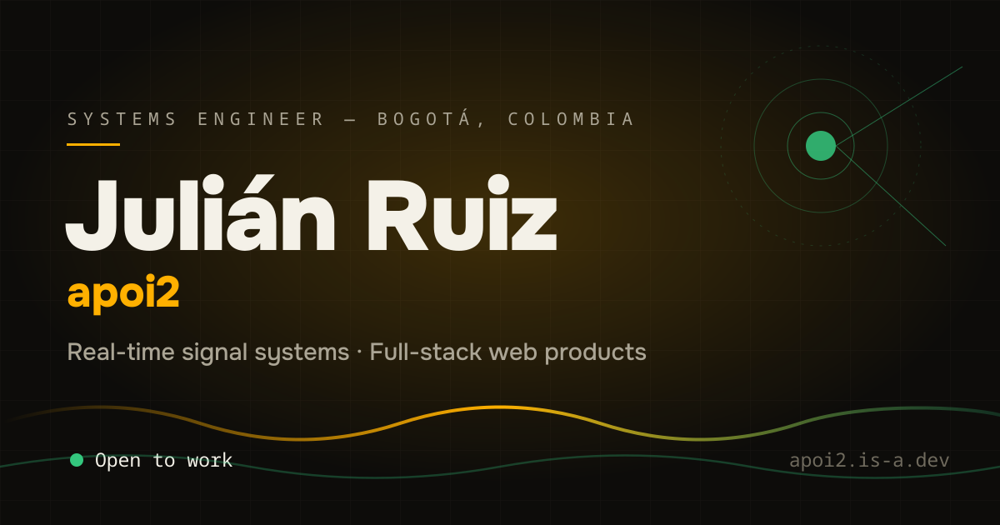
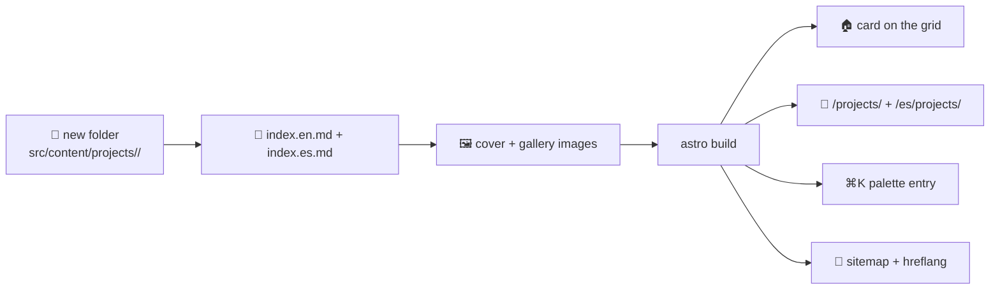
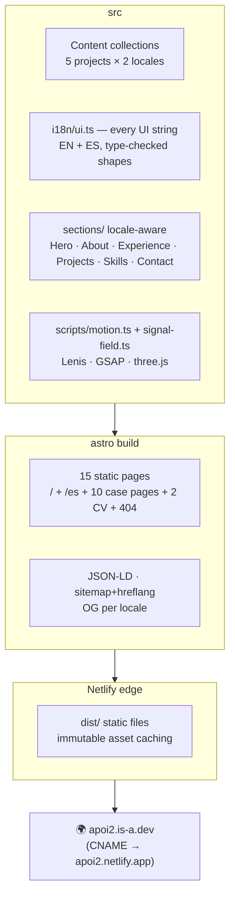

# apoi2 · portfolio.dev

**Personal portfolio of Julián David Ruiz Flórez** — systems engineer from Soacha/Bogotá, Colombia, building real-time signal systems and full-stack products. Bilingual (EN/ES), dual-theme (dark/light), motion-first, and still **100% static on Netlify**.



[](https://apoi2.netlify.app)
[](https://astro.build)
[](https://tailwindcss.com)
[](https://www.typescriptlang.org)
[](LICENSE)

**Live → [apoi2.is-a.dev](https://apoi2.is-a.dev)** · [English](https://apoi2.is-a.dev/) · [Español](https://apoi2.is-a.dev/es/) · [CV (print-ready)](https://apoi2.is-a.dev/cv)

## What's inside

| Feature | How |
| --- | --- |
| Interactive hero | three.js point-wave "signal field" — reacts to your pointer, to the theme, and speeds up as you scroll |
| Living pages | Tilt-3D project cards, a cursor that grows and speaks over cards, a REAL terminal (type `help`), image lightboxes on case pages |
| Scroll choreography | GSAP + ScrollTrigger + Lenis, all declarative (`data-reveal`, `data-stagger`, `data-counter`, `data-magnetic`, `data-tilt`) |
| Bilingual EN/ES | Full i18n routing (`/` + `/es/`), hreflang alternates, per-locale metadata & OG cards |
| Dark / light theme | CSS-variable token overrides — zero build fork, zero flash, persisted |
| Projects as content | Astro Content Collections — **add a project by adding a folder** |
| ⌘K command palette | Navigate, open cases, copy email, jump to the CV |
| Print-ready CV | `/cv` and `/es/cv` reuse the same verified data as the site |
| Easter eggs | Styled console greeting, Konami signal-boost confetti, click sparkles, hidden `sudo hire apoi2` in the palette, signal rain on the 404, tab-title wink |
| SEO | JSON-LD (Person, WebSite, CreativeWork), sitemap with hreflang, OG/Twitter cards, semantic HTML |
| Fast & resilient | Static HTML, `prefers-reduced-motion` fallbacks everywhere, no-JS still readable |

## Quick start

```bash
npm install
npm run dev       # http://localhost:4321
npm run build     # static output → dist/
npm run check     # astro check (types)
npm run verify    # post-build content/SEO/link smoke test
```

## Add a project in 3 steps

That's the whole content model — no component code, no config:

```text
src/content/projects/<your-slug>/
├── index.en.md      ← English entry (frontmatter + case body)
├── index.es.md      ← Spanish entry (same shape, translated)
├── cover.svg        ← card/OG cover (16:10 works best)
└── shot-1.webp …    ← optional gallery images
```

1. Create the folder, drop a `cover` image (SVG/PNG/WebP).
2. Write `index.en.md` + `index.es.md` — frontmatter + the case-study body.
3. Build. The card appears in the grid, the case page in both languages, and the ⌘K palette picks it up.



Full reference: [docs/CONTENT-GUIDE.md](docs/CONTENT-GUIDE.md).

## Architecture (the short version)



Deep dive: [docs/ARCHITECTURE.md](docs/ARCHITECTURE.md) · Deployment: [docs/DEPLOYMENT.md](docs/DEPLOYMENT.md).

## Project structure

```text
├── astro.config.mjs        # site URL, i18n routing, sitemap
├── netlify.toml            # build + security/cache headers
├── scripts/
│   ├── generate-og.mjs     # regenerates OG cards + favicon PNGs
│   └── verify-site.mjs    # post-build smoke test (npm run verify)
├── src/
│   ├── content.config.ts   # projects collection schema
│   ├── content/projects/   # ← THE content (folder per project)
│   ├── i18n/ui.ts          # all copy, EN + ES
│   ├── lib/                # site identity, project helpers
│   ├── components/
│   │   ├── ui/             # design-system primitives (incl. toggles)
│   │   ├── sections/       # page sections
│   │   └── …                # Nav, Footer, cards, palette, CV
│   ├── layouts/Layout.astro# SEO head, theme boot, VT
│   ├── scripts/            # motion.ts, signal-field.ts
│   └── pages/              # / , /es/ , /projects/[slug] , /cv , 404
└── public/                 # favicon suite, OG cards, robots.txt
```

## Docs index

| Doc | What you'll find |
| --- | --- |
| [ARCHITECTURE](docs/ARCHITECTURE.md) | Rendering pipeline, i18n, theming, motion system — with diagrams |
| [CONTENT-GUIDE](docs/CONTENT-GUIDE.md) | Add projects, frontmatter reference, image & i18n rules |
| [DEPLOYMENT](docs/DEPLOYMENT.md) | Netlify, the is-a.dev domain, headers, OG regeneration |

## Credits

Designed & built by **Julián Ruiz — apoi2** with Astro, Tailwind CSS, GSAP, Lenis and three.js. Motion respects `prefers-reduced-motion`. Almost all rights reserved — [MIT licensed](LICENSE).
