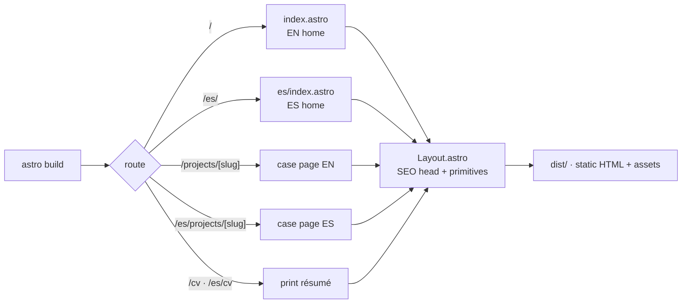
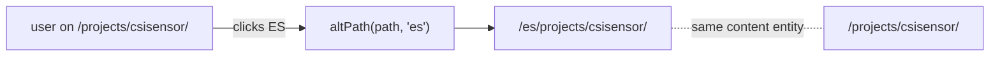
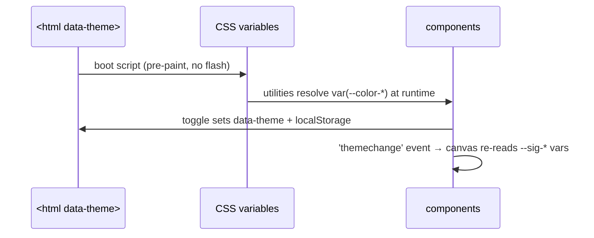

# Architecture

How the site works end-to-end: rendering, content, i18n, theming and motion.
Goal: any reader can verify the design decisions without reading all the code.

## Quick path (mental model)

1. **Content lives in folders** — `src/content/projects/<slug>/` (bilingual entries + images).
2. **Astro builds 15 static pages** from that content + the section components.
3. **Netlify serves `dist/`** from the edge; JS only enhances (motion, palette, cursor).

Everything else is detail. 🙂 Details below.

## Rendering pipeline

**Why static-only:** the site is a portfolio — content changes at commit time.
Static HTML = fastest edge serving, best SEO baseline, zero runtime on Netlify,
and the whole motion layer is progressive enhancement on top.

## Content layer

- One collection: `projects`, loaded by the glob loader from
  `src/content/projects/**/index.*.md`.
- The loader **slugifies dots**: `index.en.md` → entry id `…/indexen`,
  `index.es.md` → `…/indexes`. `src/lib/projects.ts` derives
  `slug` (folder) and `locale` (tail) from that id and exposes
  `getProjects(locale)`, `getProject`, `neighbors`, `caseHref`.
- Zod schema (`src/content.config.ts`) validates frontmatter at build time;
  `cover`/`gallery` go through Astro's `image()` so every asset is
  referenced relative to the markdown file.

**Invariant:** every project must exist in **both locales**. A missing
translation silently drops the project from that locale's grid — the
[content guide](CONTENT-GUIDE.md) makes the two-file rule explicit.

## i18n

| Decision | Choice | Why |
| --- | --- | --- |
| Routing | EN at `/`, ES at `/es/*` (Astro i18n, `prefixDefaultLocale: false`) | Keeps the existing audience on `/`; Spanish is a full mirror |
| Strings | `src/i18n/ui.ts` — `es` type-checked against the `en` shape | A missing translation is a **build error**, not a missing label |
| Content | Per-locale markdown entries in the same folder | One folder per project; images shared by both locales |
| SEO | `<link rel="alternate" hreflang>` on every page + sitemap i18n | Search engines index both languages with the right pairing |
| Switching | `LangToggle` navigates to the counterpart page (`altPath()`) | The URL is the state — no client-side language guessing |

## Theming (dark / light)

- Dark is the default; the boot `<script is:inline>` resolves
  `localStorage → prefers-color-scheme → dark` **before first paint**.
- Light mode is a single `[data-theme="light"]` block re-declaring the
  same tokens — Tailwind v4 utilities read `var(--color-*)` at runtime,
  so the entire system flips with zero build forking.
- The three.js hero reads `--sig-a/--sig-b/--sig-glow` and listens for
  `themechange`, so the canvas recolors without a reload.
- Print re-declares tokens to a paper palette for the CV (same trick).

## Motion system

| Attribute | Effect |
| --- | --- |
| `data-hero-seq="n"` | Hero entrance, staggered after `preloader:done` |
| `data-split` | Per-character reveal for display type |
| `data-reveal` (+ `fade`/`left`/`right`/`scale`, `data-reveal-delay`) | ScrollTrigger reveal |
| `data-stagger` | Stagger-reveals the element's children |
| `data-counter` | Count-up numbers (with `data-suffix`) |
| `data-magnetic` | Pointer-attracted buttons (fine pointers only) |

Lifecycle rules (all scripts follow them):

1. Every component script registers its init on **`astro:page-load`**
   (ViewTransitions swap the DOM; listeners must re-bind).
2. Window-level listeners bind **once** behind a module flag (no stacking).
3. `prefers-reduced-motion` collapses the whole system to instant states.
4. `html.js` gates the reveal-hiding CSS; a 4 s safety timer removes it if
   the motion bundle never reports ready — content can never stay invisible.

## Next step

- Add content → [CONTENT-GUIDE.md](CONTENT-GUIDE.md)
- Ship it → [DEPLOYMENT.md](DEPLOYMENT.md)
